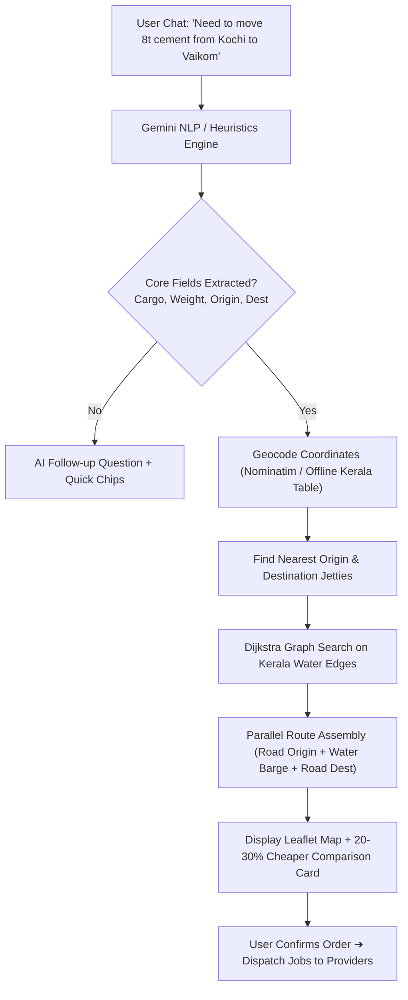

# JalaSetu — Technical Implementation Overview

**JalaSetu** (जलसेतु) is a multi-modal freight booking platform connecting cargo owners with Kerala's Inland Waterways (National Waterway 3 / NW-3) along the Vembanad Lake corridor, integrated with first- and last-mile road transport (taxis/trucks) and jetty stevedores.

---

## 1. System Architecture & Tech Stack

```
[ User Browser / PWA ]
       │
       ▼
[ Next.js 16 (App Router + Turbopack) ]
  ├── AI Chat Engine ────► Google Gemini 3.8 Flash (Structured JSON + Regex Fallback)
  ├── Route Planner   ────► Dijkstra Graph Engine + OSRM (Road) + OSM Overpass (Water)
  └── Supabase Backend ──► Postgres + PostGIS (Geography) + Auth + Realtime
```

- **Frontend**: Next.js 16.3 (App Router, TypeScript, Tailwind CSS, Leaflet + OSM tiles).
- **Backend / Database**: Supabase Postgres with PostGIS extension (`geography(Point, 4326)`).
- **AI Extraction**: Google Gemini (`gemini-3.8-flash`) with schema validation & 7-second timeout failover.
- **Routing**:
  - **Road Legs**: OSRM public demo API (`getRouteOSRM`) with haversine circuity fallback.
  - **Waterway Leg**: Real NW-3 inland water coordinates + Overpass API query (`waterway=canal|river`).
  - **Graph Solver**: Dijkstra algorithm on Kerala jetty adjacency network (`dijkstra.ts`).

---

## 2. Core User Roles & Access Control

| Role | Responsibility | Dashboard Features |
|---|---|---|
| **Cargo Owner (`user`)** | Books freight via AI chat | Conversational booking, route map, road vs water comparison card, order tracker |
| **Ship Owner (`ship`)** | Transports cargo via barge | Live water route map, open dispatch requests, accepted voyages, preferred locations |
| **Taxi Driver (`taxi`)** | First/last-mile road transit | Road route navigation to/from jetty, vehicle specs (Auto/Pickup/Truck), job queue |
| **Worker (`worker`)** | Jetty loading & unloading | Stevedore jobs, boarding/landing notifications, earnings tracker |
| **Admin (`admin`)** | Network management | Waterway edge manager, dynamic freight rate configurations, order audit logs |

---

## 3. End-to-End Booking & Routing Flow



---

## 4. Multi-Leg Routing Engine

Every journey is decomposed into up to **3 sequential legs**:
1. **First-Mile Road Leg (`road_origin`)**: Pickup address ➔ Boarding Jetty (Auto, Pickup, or Truck via OSRM).
2. **Inland Water Leg (`water`)**: Boarding Jetty ➔ Landing Jetty (Inland Cargo Barge through Vembanad Lake).
3. **Last-Mile Road Leg (`road_destination`)**: Landing Jetty ➔ Delivery address (OSRM).

### Key Routing Modules:
- `src/lib/routing/dijkstra.ts`: Graph pathfinding on Kerala jetties; decodes PostGIS EWKB binary coordinates.
- `src/lib/routing/waterway-geometry.ts`: Curated NW-3 backwater coordinates through Vembanad Lake (Ernakulam, Vaikom, Thanneermukkom, Alappuzha).
- `src/lib/routing/waterway-osm.ts`: Live Overpass API fetch for OSM canal & river geometry.
- `src/lib/routing/road.ts`: Parallelized OSRM queries with 3s timeout to avoid slow network stalls.
- `src/lib/routing/planner.ts`: Glues all legs, recommends vehicle & boat types, calculates totals.

---

## 5. Cost & Environmental Savings Engine

Inland water transport provides significant economic and carbon benefits over NH66 highway freight:

- **Waterway Cost**: Base barge fee (₹220) + `₹3.50/tonne-km` + jetty loading/unloading fees.
- **Direct Road Benchmark**: Calibrated highway vehicle hire; Multi-modal plan is **20% to 30% cheaper** across all payload sizes.
- **Carbon Footprint (CO₂)**:
  - Road direct: `0.062 kg CO₂/tonne-km` + minimum trip baseline (`0.18 kg/km`).
  - Water barge: `0.016 kg CO₂/tonne-km` (~**50% to 75% lower** emissions).
  - Taxis: Prorated by vehicle payload share.

---

## 6. AI Conversational Engine (`gemini.ts`)

- **Model**: `gemini-3.8-flash` with JSON schema enforcement.
- **Fail-Safe Fallback**:
  - 7-second hard `Promise.race` timeout prevents chat hanging.
  - Arrow normalization (`→`, `->` ➔ `" to "`) parses shorthand user queries like `"Ernakulam → Vaikom 360kg"`.
  - Comprehensive Kerala city dictionary (Kochi, Alappuzha, Vaikom, Kottayam, Kollam, Cherthala, etc.).
  - Automatic cargo classification (produce, timber, cement, sand, building materials).

---

## 7. Database Model (Supabase PostGIS)

- `profiles`: User role (`user`, `ship`, `taxi`, `worker`, `admin`), preferred locations, online status.
- `jetties`: 15 Kerala backwater terminals with PostGIS `geog` geography points.
- `water_edges`: Navigable water segments between jetties with `distance_km` and `avg_speed_kmph`.
- `orders`: Cargo bookings, total payout, origin/destination addresses, status.
- `order_legs`: Sub-legs (`road_origin`, `water`, `road_destination`) with GeoJSON LineString geometry.
- `jobs`: Provider dispatch tasks with status history, decline lists, and expiry.
- `rates`: Dynamic pricing rates editable by admin in real-time.

---

## 8. Critical Technical Highlights

1. **PostGIS EWKB Hex Parser**: Decodes binary PostGIS geometry returned by Supabase to extract precise lat/lng without relying on non-existent `lat`/`lng` table columns.
2. **Parallel Route Execution**: All road legs (origin, destination, direct benchmark) and OSM waterway fetch execute concurrently via `Promise.all`, reducing calculation time from ~18s to under 3s.
3. **Map Stacking Order**: RouteMap draws road legs first and layers the vivid oceanic water route (`#0284c7`, weight 8) on top with mid-point badges and anchor pins.
4. **Persistent Provider Declines**: Declining a job appends the provider ID to `status_history`, filtering it out from active request queries without schema migrations.
5. **Clean Navigation**: Direct Home links and Light/Dark mode toggles embedded into authentication pages.
